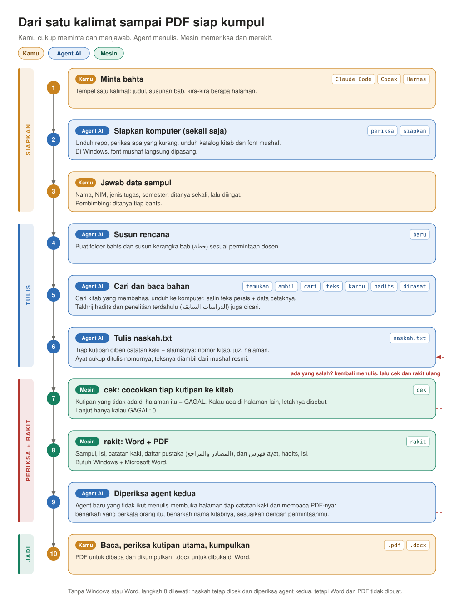
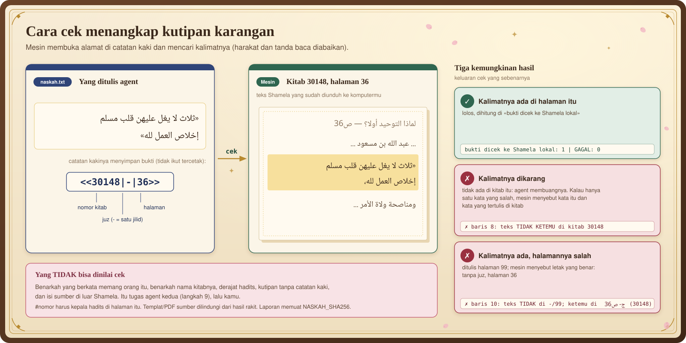
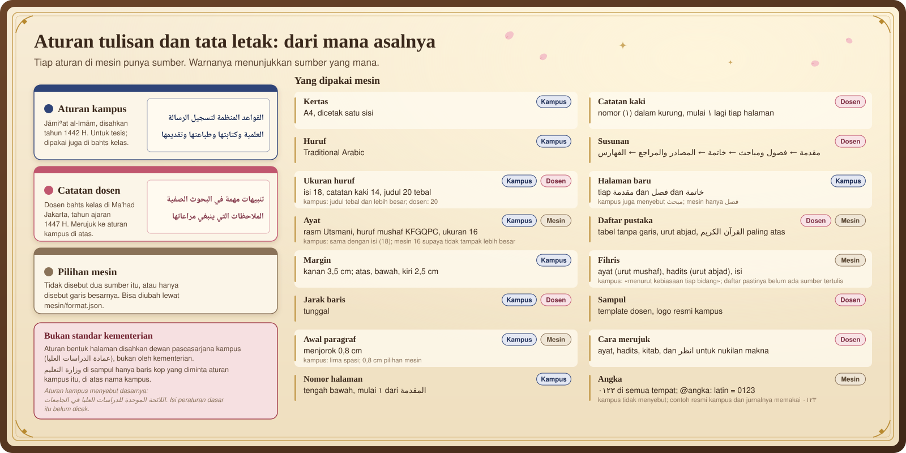

# Mesin Bahts


[](https://github.com/Farisarditiyanto/mesin-bahts/actions/workflows/tes.yml)
[](https://github.com/Farisarditiyanto/mesin-bahts/releases)
[](LICENSE)

Tulis **بحث** (makalah syar'i berbahasa Arab) bersama agent AI. **Tiap kutipan dicocokkan ke halaman kitabnya** sebelum jadi PDF.

Agent AI pandai menulis, tetapi bisa mengarang kutipan. Di mesin ini:

- Agent mengutip kitab المكتبة الشاملة yang sudah diunduh ke komputermu. Sumber lain (jurnal, PDF penelitian) ditandai untuk kamu periksa sendiri.
- Tiap kutipan membawa alamat di catatan kakinya: kitab, juz, halaman.
- Mesin membuka alamat itu. Kutipan yang tidak ada di sana, atau tanpa alamat, ditolak.
- Ayat ditulis dari mushaf مجمع الملك فهد. Word dan PDF dirakit lengkap: sampul, catatan kaki, المصادر والمراجع, dan الفهارس.

## Mulai

1. Buka agent AI yang membaca `AGENTS.md`. Tidak harus berbayar: [OpenCode](https://opencode.ai) dan [Hermes Agent](https://hermes-agent.nousresearch.com) bisa dipakai gratis, [Command Code](https://commandcode.ai) mulai $1/bulan (lihat «[Agent AI](#agent-ai)»).
2. Tempel kalimat ini, ganti judulnya:

   > Pakai https://github.com/Farisarditiyanto/mesin-bahts untuk membuatkan saya bahts tentang الإخلاص وأثره في قبول العمل. Susunannya: مقدمة, satu فصل berisi dua مبحث, خاتمة. Kira-kira 6 halaman.

3. Jawab pertanyaan agent: nama, nomor mahasiswa, jenis tugas, semester, pembimbing. Kamu tidak perlu mengetik perintah.

Hasilnya ada di folder `mesin-bahts` di dalam folder Dokumen-mu.

Catatan untuk agent AI: lanjutkan dari [`AGENTS.md`](AGENTS.md), bagian «Pemakai baru».

## Cara kerjanya





## Batasnya

- `cek` hanya membuktikan bahwa teksnya ada di halaman itu. Ia tidak menilai siapa yang berkata, derajat hadits, kutipan tanpa catatan kaki, atau sumber di luar Shamela. Itu diperiksa agent kedua (tanpa subagent: buka sesi agent baru), lalu kamu. **Periksa sendiri kutipan utamamu.**
- Teks kitab adalah ketikan Shamela, jadi bisa salah ketik.
- Model AI gratis lebih sering salah langkah. `cek` tetap menolak kutipan tanpa bukti, tetapi pemeriksaan agent kedua dan pemeriksaanmu makin penting.
- Nama di sampul namamu: isinya tanggung jawabmu. Tanyakan ke dosen apakah bantuan AI dibolehkan.
- Proyek ini tidak mewakili kampus mana pun.

## Yang dibutuhkan

| Untuk | Butuh |
|---|---|
| Menulis bahts | Satu agent AI yang membaca `AGENTS.md` (ada yang gratis, lihat di bawah) |
| Semua perintah | Python 3.12 ke atas, internet saat mengunduh kitab |
| Word dan PDF (`rakit`) | Windows dan Microsoft Word desktop |

Mac/Linux bisa menulis dan `cek`, tanpa Word dan PDF. `python mesin/bahts.py periksa` menyebut apa yang kurang dan cara membereskannya.

### Agent AI

Semua agent di bawah membaca `AGENTS.md`, jadi caranya sama: tempel kalimat di «Mulai», lalu jawab pertanyaannya.

| Agent | Biaya | Connector |
|---|---|---|
| [OpenCode](https://opencode.ai) | Gratis. Punya model gratis; daftarnya berganti-ganti (`/models`) | Terbaca sendiri dari `opencode.json` |
| [Command Code](https://commandcode.ai) | Mulai $1/bulan (paket Go), sudah termasuk model gratis; daftarnya berganti-ganti | Terbaca sendiri dari `.mcp.json` |
| [Hermes Agent](https://hermes-agent.nousresearch.com) | Gratis, sumber terbuka. Modelnya kamu sambungkan sendiri | Agent mendaftarkannya sesudah minta izinmu |
| [Claude Code](https://claude.com/claude-code) | Berbayar | Terbaca sendiri dari `.mcp.json` |
| Codex | Akun ChatGPT | Agent mendaftarkannya sesudah minta izinmu |

Sebagian model gratis memakai isi obrolan untuk melatih modelnya. Baca keterangan modelnya sebelum memilih.

Connector = sambungan MCP: dua nama untuk barang yang sama. Aplikasi Claude: tab Code adalah Claude Code, jadi `.mcp.json` terbaca di sana, begitu juga connector yang kamu tambahkan di menu Connectors aplikasi Claude. Aplikasi Codex memakai pengaturan connector yang sama dengan Codex di terminal. OpenCode dan Command Code juga punya aplikasi desktop; belum dicoba. Mode obrolan biasa (Claude chat, ChatGPT) tidak bisa menjalankan mesin: pilih mode yang membuka folder dan menjalankan perintah.

Connector `shamela` belum bisa masuk di Command Code: shamela.link menolak cara daftarnya, dan repo ini belum menyiapkan jalan lain. Connector lain tetap jalan.

## Pilihan

- **Connector `shamela`** (sangat disarankan): agent bisa mencari kitab yang belum diunduh. Sudah terdaftar di repo (lihat «[Agent AI](#agent-ai)»); masuk dengan akun shamela.link sendiri. Connector lain tanpa akun: `turath`, `hadithunlocked`, `tafsir`, `quran`. Semuanya layanan orang lain; tanpa itu mesin tetap jalan.
- **Kunci OpenAlex** untuk `dirasat` (penelitian terdahulu): tanpa kunci jatahnya kecil dan `dirasat-pdf` tertutup. Daftar di https://openalex.org, salin dari Settings > API key, simpan di `kunci_openalex.txt` (atau variabel `OPENALEX_API_KEY`).

## Tanpa agent

```bash
git clone https://github.com/Farisarditiyanto/mesin-bahts.git
```

```bash
cd mesin-bahts
```

```bash
python mesin/bahts.py periksa
```

Daftar perintah: `python mesin/bahts.py`. Daftar tanda naskah: `python mesin/bahts.py tanda`. Contoh: [`contoh/naskah.txt`](contoh/naskah.txt); coba dengan `python mesin/bahts.py ambil 11223`, lalu `python mesin/bahts.py cek contoh`.

## Standar halaman



Dasarnya «[القواعد المنظمة لتسجيل الرسالة العلمية وكتابتها وطباعتها وتقديمها](https://units.imamu.edu.sa/colleges/cmc/AcademicDepts/SiteAssets/Pages/d_j_e_p/%D8%A7%D9%84%D9%82%D9%88%D8%A7%D8%B9%D8%AF%20%D8%A7%D9%84%D9%85%D9%86%D8%B8%D9%85%D8%A9%20%D9%84%D8%AA%D8%B3%D8%AC%D9%8A%D9%84%20%D8%A7%D9%84%D8%B1%D8%B3%D8%A7%D9%84%D8%A9%20%D8%A7%D9%84%D8%B9%D9%84%D9%85%D9%8A%D8%A9.pdf)» (جامعة الإمام, 1442 H) dan catatan dosen bahts kelas معهد العلوم الإسلامية والعربية في جاكرتا. Kampus atau dosen lain: ganti `mesin/sampul.doc` dan tambah profil di `mesin/format.json`.

Angka: aturan kampus dan catatan dosen tidak menyebut jenis angka. Contoh resmi kampus memakai ٠١٢٣ di nomor halaman, catatan kaki, rujukan, tahun, nomor ayat, dan فهرس: «[دليل إعداد وكتابة الرسائل العلمية](https://units.imamu.edu.sa/shis/sij/FilesLibrary/Documents/Guide%20to%20preparing%20and%20writing%20scientific%20theses.pdf)» (جامعة الإمام, cetakan kedua) dan «[مجلة العلوم الشرعية](https://journals.imamu.edu.sa/index.php/jis)». Jadi PDF mencetak ٠١٢٣ di semua tempat itu, apa pun angka yang diketik di naskah. Dosen minta 0123: tulis `@angka: latin` di naskah.

## Lain-lain

- Naskah, PDF, `sampul_saya.txt`, dan `kitab/` tetap di komputermu, tidak ikut repo.
- Lisensi kode: MIT ([`LICENSE`](LICENSE)). Teks mushaf, font, logo, dan teks kitab: [`NOTICE`](NOTICE).
- Masalah: buka issue dengan keluaran `periksa`, perintahnya, dan pesannya. Perubahan: pull request dengan tes hijau. Riwayat: [`CHANGELOG.md`](CHANGELOG.md).
